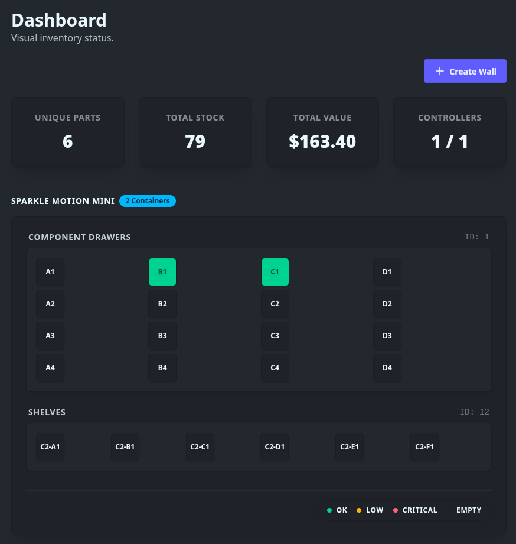
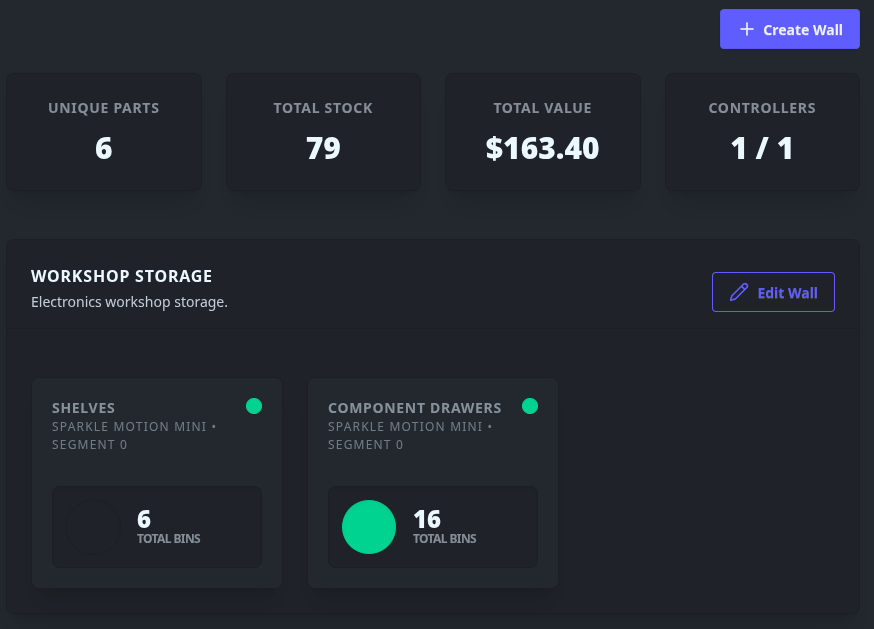
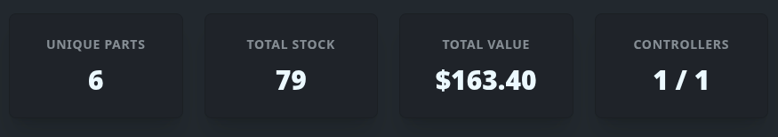

# The Dashboard

The Dashboard gives you a real-time visual overview of your inventory, displaying WLED controller connectivity, unique part count, total stock count, total inventory value, and color-coded storage bin maps.

You can use the [Default View](#default-view) or build custom [Walls](#walls).

## Default View

<a href="/img/feature-guide/dashboard_default.png" target="_blank">
   
</a>

By default, the dashboard groups your containers by WLED controller alongside any controller-less **Standalone Containers**. Each bin reflects the live stock status of the parts inside it.

### Visual Hierarchy

```text
Dashboard/
├── WLED Controller 01
│   ├── Container A (Drawers)
│   │   ├── Bin 1 (Width: 1 LED)
│   │   └── Bin 2 (Width: 2 LEDs)
│   └── Container B (Box)
│       └── Bin 1
└── Standalone Containers (No WLED Controller)
    └── Travel Case #1
        ├── Bin A1
        └── Bin A2
```

## Walls

<a href="/img/feature-guide/dashboard_wall.png" target="_blank">
   
</a>

Walls let you group any mix of WLED-attached containers and Standalone Containers into custom workshop views (for example, `SMD Rack`, `Bench Top`, or `Travel Kit`).

### Creating a Wall

<video width="100%" controls muted>
   <source src="/videos/wledger_dashboard_create_wall.mp4" type="video/mp4" />
   Oops! Your browser does not support video rendering.
</video>

## Status Indicators

Bin and Wall colors dynamically pull from your customized colors in [Settings](./settings.md):

* 🟢 **OK (`--color-stock-ok`):** Above reorder threshold
* 🟡 **Low (`--color-stock-low`):** At or below reorder level
* 🔴 **Critical (`--color-stock-critical`):** At or below minimum stock level
* ⚫ **Empty:** No inventory assigned

Standalone containers display a clean **Standalone** badge instead of an offline controller status dot.

## Inventory Stats

View total unique parts, total unit stock, total inventory value, and real-time online/offline status across your WLED controllers.

<a href="/img/feature-guide/dashboard_stat_cards.png" target="_blank">
   
</a>
