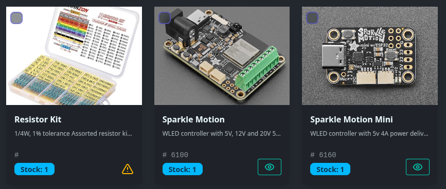
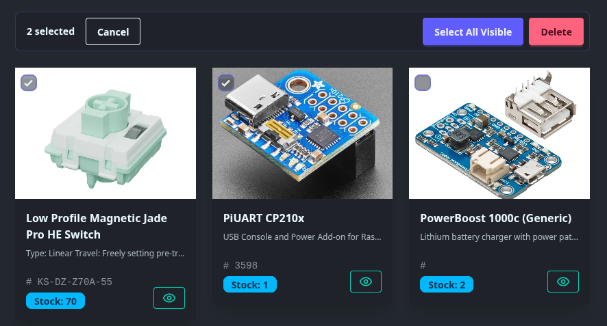
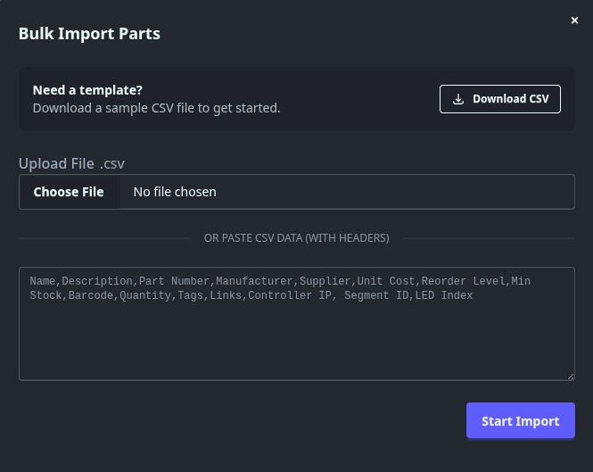

# Inventory Management

WLEDger provides a high-performance inventory database powered by pure-Go SQLite FTS5. Organize your components, scan 2D supplier bags directly from your bench or phone, track physical locations across WLED and Standalone containers, and monitor stock levels.

## Part Cards

Each part in your inventory appears as a Part Card showing:

* Thumbnail Image (automatically served as `_thumb.jpg` with full-resolution view on Part Details)
* Part Name & Description
* MPN
* Total Stock Count

### Locate

If a part has positive stock assigned to a WLED-backed bin, the **Locate** button (👁️ icon) appears on the Part Card and Part Details page.

<a href="/img/feature-guide/part_card_actions.png" target="_blank">
   
</a>

A ⚠️ icon indicates **orphaned stock** (stock not currently assigned to a valid bin). Click the Part Card to reassign orphaned stock to a valid bin or adjust its quantity directly.

:::info What is Orphaned Stock?
Orphaned stock occurs when a bin or container is deleted while parts still have stock in it, or when stock has not been placed into a physical bin yet. Deleting multiple bins automatically merges their orphaned stock per part cleanly.
:::

### Bulk Delete

Select one or more Part Cards to delete parts in bulk.

<a href="/img/feature-guide/part_card_bulk_delete.png" target="_blank">
   
</a>

---

## Parts, Details & 2D Supplier Barcode Scanning

Click any Part Card to inspect details, datasheets, stock locations, and edit history.

### Create and Edit

<video width="100%" controls muted>
   <source src="/videos/create_edit_part_demo.mp4" type="video/mp4" />
   Oops! Your browser does not support video rendering.
</video>

### 2D Supplier Barcode Auto-Fill (DigiKey, Mouser, LCSC)

When adding or editing a part, you can scan or paste component bag labels to automatically populate fields:

* **Camera Scanner:** Uses the browser's native `BarcodeDetector` (DataMatrix, PDF417, QR, Code128, EAN-13, UPC-A) with `html5-qrcode` fallback.
  * *Mobile LAN Note:* Enable `WLEDGER_TLS_SELF_SIGNED=true` (or an HTTPS reverse proxy) so mobile browsers grant camera permission over LAN.
* **USB / Bluetooth Scanners & Paste:** Scan directly into the **Barcode** field or paste raw label data and trigger parsing (`POST /parts/parse-barcode`).
* **Supported Formats:**
  * **DigiKey & Mouser:** ANSI MH10.8.2 / TIA-1063 / ECIA DataMatrix & PDF417 labels (`1P` MPN, `P` supplier PN, `1V`/`V` manufacturer, `Q` quantity, `K`/`1K` order/PO).
  * **LCSC:** Unquoted or quoted JSON QR/DataMatrix payloads (`{pbn, on, pc, pm, qty}`) and colon/comma key-value strings (`pc:C14663,pm:...,qty:50`).
  * **1D Barcodes:** Standard EAN, UPC, and Code128 barcodes.
* **Duplicate Detection:** WLEDger automatically checks your database and alerts you if a scanned barcode or MPN matches an existing part.

### Part Detail Fields

:::info
`Part Name` is the only required field.
:::

| Field | Purpose | Usage Tips |
| :--- | :--- | :--- |
| **Name** | The primary identifier for the part. | Use an easily recognizable name (e.g., `ESP32-WROOM-32`). |
| **Tags** | Custom, reusable labels. | Comma-separated or entered cleanly on blur/submit (e.g., `3.3V`, `SMD`, `0805`). |
| **Description** | Detailed technical information. | Fully searchable via FTS5. |
| **Cover Image** | Thumbnail and detail photo of the part. | Validated safely for image dimensions before decoding. |
| **MPN** | Manufacturer Part Number. | Used for search, supplier barcode matching, and BOM auto-linking. |
| **Manufacturer** | The component manufacturer. | Useful for filtering (e.g., `Texas Instruments`). |
| **Supplier** | Preferred distributor or vendor. | Auto-filled from DigiKey/Mouser/LCSC 2D labels. |
| **Barcode** | Unique 1D or 2D barcode identifier. | Supports scanning, auto-fill, and duplicate part lookup. |
| **Unit Cost** | Cost per unit in dollars. | Used to calculate total inventory value on the Dashboard. |
| **Min Stock Level** | Threshold for "Critical" stock status. | Highlighted in red on Dashboard & Part Details. |
| **Reorder Level** | Threshold for "Low" stock status. | Highlighted in amber/yellow on Dashboard & Part Details. |
| **External Links** | Custom HTTP/HTTPS reference links. | Useful for distributor product pages or online datasheets. |
| **Documents** | Uploaded datasheets and reference files. | Allowed types: `.pdf`, `.txt`, `.md`, `.csv`, `.json`, `.png`, `.jpg`, `.jpeg`, `.webp`, `.gif` (served securely behind authentication). |

---

## Bulk Import

Import large part lists at once via CSV file upload or raw CSV paste.

<a href="/img/feature-guide/bulk_import.png" target="_blank">
   
</a>

### Preparing Your CSV Data

Download the template from the Bulk Import modal. You can assign locations either by **WLED Controller** (`Controller IP`, `Segment ID`, `LED Index`) or by **Standalone Container** (`Container`, `Bin Name` or `LED Index`):

```csv
Name,Description,Part Number,Manufacturer,Supplier,Unit Cost,Reorder Level,Min Stock,Barcode,Quantity,Tags,Links,Controller IP,Container,Bin Name,Segment ID,LED Index
10k 0805 Resistor,1% 1/8W,RC0805FR-0710KL,Yageo,DigiKey,0.02,50,10,12345678,100,Resistor|SMD,https://example.com/ds,192.168.1.100,,,0,5
Travel Tweezers,ESD safe angled tweezers,,,Amazon,8.50,2,1,,1,Tools,, ,Travel Case #1,A1,,
```

* Use the pipe `|` delimiter inside **Tags** and **Links** columns.
* Images are not included in CSV import and can be added afterward on the part edit page.

---

## Stock & Locations

A single part can live in multiple WLED-backed bins, Standalone Containers, or unassigned orphaned stock rows.

1. Open any **Part Details** page.
2. Click **Add Stock** to pick a WLED controller or **Standalone** container, choose a bin, and set the quantity.
3. Use `+` / `-` buttons to adjust stock inline (updating the header **Total In Stock** badge immediately), or **Move** stock between bins.
4. Every adjustment is recorded in [Audit Logs](./audit-logs.md).

---

## Fast FTS5 Search & Filter Preservation

Powered by pure-Go SQLite **FTS5**, search queries evaluate across Name, Description, Tags, MPN, Manufacturer, Supplier, and Barcode simultaneously:

* **Technical Strings Supported:** Punctuation and hyphens in component queries such as `ESP32-S3`, `USB-C`, `JST-XH`, `0.1uF`, `3.3V`, or `10k/1%` are safely sanitized so FTS5 never fails on special characters.
* **Preserved Filters:** Active tag, bin, controller, stock-level, and sort filters are preserved automatically while typing in the search bar or scrolling.
* **Keyboard Shortcut:** Press `Ctrl+K` / `Cmd+K` anywhere in WLEDger to jump directly to search.
