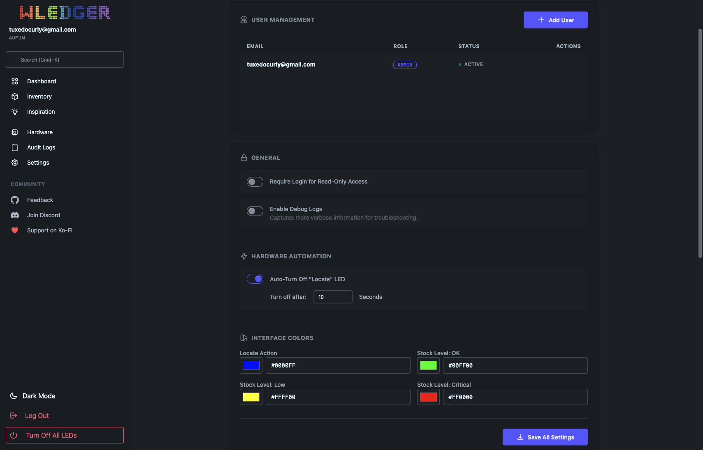

# Settings

The Settings panel is the control center for your WLEDger instance. Manage users and roles, create scoped **Personal Access Tokens** for the REST API, configure guest read access, customize locate automation and colors, back up or restore your system, and update your password.

## User Management

Admins can create, delete, and force password resets on user accounts.

* **Password Policy:** All passwords (initial setup, user creation, forced reset, and self-service password change) require **8–72 bytes** and are hashed with bcrypt cost `12`.
* **Force Reset:** Newly created users (and users flagged with Force Reset) must choose a new password on their next login.

## Roles & Permissions

| Feature | Admin | Editor | Viewer | Guest |
| :--- | :---: | :---: | :---: | :---: |
| **Search & View Inventory / Projects** | ✅ | ✅ | ✅ | ✅ |
| **Locate (Light up WLED Bins)** | ✅ | ✅ | ✅ | ✅ |
| **Add / Edit / Delete Parts & BOMs** | ✅ | ✅ | ❌ | ❌ |
| **Adjust Stock & Build Projects** | ✅ | ✅ | ❌ | ❌ |
| **Manage Hardware (WLED & Containers)** | ✅ | ❌ | ❌ | ❌ |
| **Manage Users, Settings & Backups** | ✅ | ❌ | ❌ | ❌ |

:::info Guest Access
When **Require Login for Read-Only Access** is **disabled**, unauthenticated visitors receive read-only **Guest** permissions (including viewing inventory and locating parts). When enabled, all routes—including uploaded images and datasheets under `/uploads/*`—require authentication.
:::

---

## Personal Access Tokens (API Tokens)

Generate scoped **Personal Access Tokens** (`wlg_...`) in Settings to authenticate against the [REST API v1](./api.md):

1. Enter a descriptive **Name** (e.g., `KiCad Sync Script`), choose a **Scope** (`read`, `write`, or `admin`), and set an optional expiration in days.
2. Click **Create Token**.
3. **Copy the token immediately** from the one-time reveal banner — WLEDger stores only a **SHA-256 hash** (`token_hash`) and cannot display the plaintext token again.
4. A token's effective permissions are bounded by both its chosen scope and your account role (for example, a `viewer` user cannot obtain `write` or `admin` access via a token).
5. Revoke any token at any time from the tokens table.

---

## General Settings

* **Require Login for Read-Only Access:** Requires login for viewing parts, dashboards, and uploaded images/documents.
* **Enable Debug Logs:** Toggles verbose `DEBUG` structured JSON logging at runtime without restarting the server.

---

## Hardware Automation & Colors

* **Auto-Turn Off "Locate" LED:** Sets how many seconds locate LEDs stay illuminated before restoring the controller's prior WLED state, activating its Idle Preset, or turning LEDs off.
* **Periodic Controller Status Ping:** Pings all configured WLED controllers in the background (`Ping every:` default `600` seconds, valid range `10`–`86400` seconds) to keep **Online** / **Offline** badges and LED counts fresh across the Dashboard and Hardware pages. Saving updates the background schedule immediately without restarting WLEDger.
* **Interface Colors:** Customize hex colors for **Locate Action**, **Stock Level: OK**, **Stock Level: Low**, and **Stock Level: Critical**. Changes dynamically update both the Dashboard UI CSS variables and WLED bin colors (when stock-health locate coloring is enabled).

---

## Backup & Restore

| Action | Purpose |
| :--- | :--- |
| **Create Backup** | Downloads a portable `.zip` archive containing your full V2 database (parts, projects/BOMs, hardware, containers, walls, users, settings, audit logs, prompts) and uploaded images/documents. |
| **Restore Backup** | Atomically replaces the active database and uploads from a `.zip` backup (with ZipSlip & archive size protection). Clears active sessions and API tokens for security—you will be asked to log back in afterward. |

---

## Change Password

Any authenticated user can update their password in Settings by confirming their current password and entering a new 8–72 character password.
